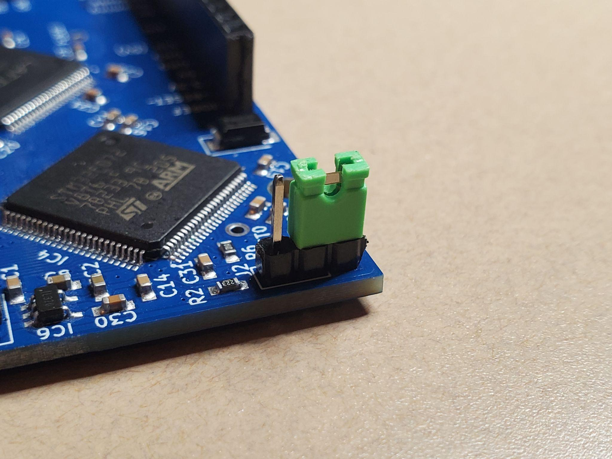
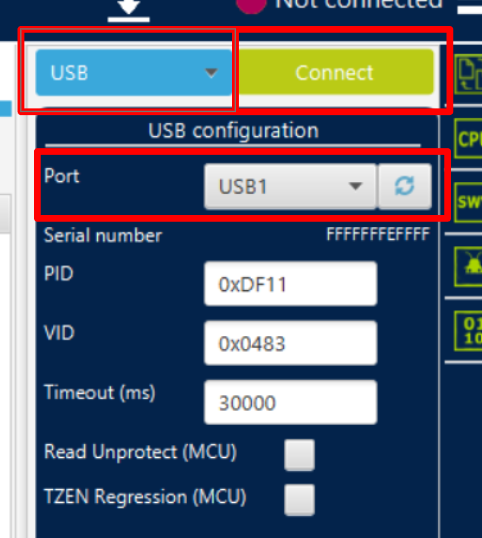
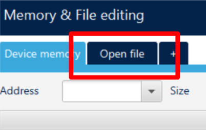
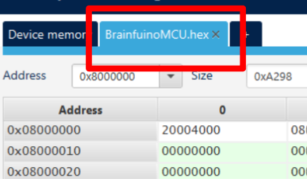
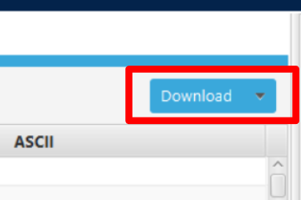
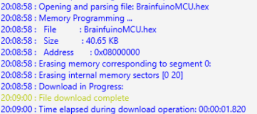

# Building & Flashing STM32 Firmware

The companion MCU firmware is organized as an **STM32CubeIDE** project located under [`companion-STM32-firmware/`](https://github.com/m-archibald/Brainfuino/tree/main/companion-STM32-firmware).

A pre-built production binary is always kept ready at:
[`companion-STM32-firmware/Debug/BrainfuinoMCU.hex`](https://github.com/m-archibald/Brainfuino/blob/main/companion-STM32-firmware/Debug/BrainfuinoMCU.hex).

---

## Toolchain Setup

To modify or rebuild the firmware:

1. Download and install [STM32CubeIDE](https://www.st.com/en/development-tools/stm32cubeide.html) (free from STMicroelectronics, cross-platform for Windows, Linux, and macOS).
2. Launch STM32CubeIDE and select your workspace directory.
3. Go to **File → Import → General → Existing Projects into Workspace**.
4. Browse to the root of `companion-STM32-firmware/` and click **Finish**.

---

## Rebuilding the Project

1. In the Project Explorer, right-click `BrainfuinoMCU`.
2. Select **Build Project** (or press ++ctrl+b++ / ++cmd+b++).
3. The GCC ARM toolchain compiles the STM32 HAL drivers, USB Device library, and `main.c`.
4. The output `.elf`, `.bin`, and `.hex` files are generated in the `Debug/` folder.

---

## Automated Command-Line Build & Flash Script

For the fastest development workflow, a cross-platform PowerShell automation script is provided at [`companion-STM32-firmware/build.ps1`](https://github.com/m-archibald/Brainfuino/blob/main/companion-STM32-firmware/build.ps1):

* **Compile Only:**
  ```powershell
  pwsh companion-STM32-firmware/build.ps1 -CompileOnly
  ```
  Locates the embedded GCC ARM toolchain automatically, compiles startup assembly and C sources, links the ELF binary, and generates `Debug/BrainfuinoMCU.hex`.

* **One-Click Build & Flash (over USB DFU):**
  ```powershell
  pwsh companion-STM32-firmware/build.ps1 -Flash
  ```
  Automatically compiles, auto-detects the Brainfuino virtual COM port, sends the `!DFU!` trigger command to reboot the STM32 into its factory USB DFU bootloader, connects via `STM32_Programmer_CLI`, flashes the binary, and immediately resumes program execution. **No jumper movement needed!**

---

## Automated Hardware Verification Test Suite

Hardware functionality and menu workflows can be verified end-to-end against a live Brainfuino board connected over USB:

* **Menu, Program Library, and TOC Test:**
  ```powershell
  python scripts/test_library_and_menu.py
  ```
  Runs an automated 10-stage test validating menu rendering, Left/Right arrow cycling, program addition and comment pruning, pre-run verification skipping (`n`), live FPGA execution, and zero-erase tombstone deletion.

* **Clock Speed & Printing Strobe Test:**
  ```powershell
  python scripts/test_logo_all_speeds.py
  ```
  Cycles through all 25 FPGA clock frequencies (from 10 Hz PWM up to 12 MHz MCO) and verifies zero dropped characters during high-speed execution.

---

## Flashing the Microcontroller

There are several convenient methods to flash firmware onto the STM32F072:

### Method 1: WebUSB Browser Flasher (1-Click, Zero Install)

The fastest and easiest way to flash firmware is right inside your browser with the [Web Serial Terminal](../web-terminal.html#flash):

1. Connect Brainfuino to your PC with a USB-C data cable.
2. Open the [Web Serial Terminal](../web-terminal.html#flash) and navigate to the **Flasher** tab.
3. Under **Target Component**, select **STM32 Coprocessor MCU**.
4. Select a release binary from the dropdown (or drag and drop your freshly compiled `BrainfuinoMCU.hex`).
5. Click **Flash Firmware**:
    * If connected via serial, the terminal automatically sends `!DFU!` to soft-reboot the STM32 into factory DFU mode.
    * The browser prompts to authorize the **STM32 BOOTLOADER** (`0483:df11`).
    * The WebUSB flasher erases flash pages, writes the new binary, verifies checksums, and reboots Brainfuino back into run mode—all in under 5 seconds!

---

### Method 2: Automated Command-Line Script (`build.ps1 -Flash`)

For automated terminal workflows:

1. Connect Brainfuino to your PC via USB-C.
2. Run `pwsh companion-STM32-firmware/build.ps1 -Flash`.
3. The script auto-detects the COM port, sends the `!DFU!` token, and uses `STM32_Programmer_CLI` to flash and reboot without touching hardware jumpers.

---

### Method 3: Manual Hardware Boot Jumper DFU (STM32CubeProgrammer)

If you ever flash a corrupt binary that hangs before USB initialization, you can always enter the factory DFU bootloader using the physical hardware header:

1. **Set DFU Mode:**
    * Place the jumper into the **BOOT** position (pulls `BOOT0` HIGH to 3.3V).
    
    

2. **Connect Hardware:**
    * Connect the Brainfuino to your computer using a **USB-C data cable**.

3. **Connect in STM32CubeProgrammer:**
    * Launch **STM32CubeProgrammer**.
    * In the top-right connection panel, select **USB** from the drop-down menu, verify that **Port USB1** appears (click the refresh icon if needed), and click **Connect**.
    
    

4. **Open the Firmware Binary:**
    * Click the **Open file** tab in the top bar:
    
    
    
    * Browse and select `BrainfuinoMCU.hex` (found under `companion-STM32-firmware/Debug/` or downloaded from the GitHub release).
    * The **BrainfuinoMCU.hex** tab will load, showing the firmware mapped to starting flash address `0x08000000`:
    
    

5. **Download & Flash Firmware:**
    * Click the blue **Download** button:
    
    
    
    * The programmer will erase sectors and write the firmware. Verify the console displays **File download complete**:
    
    

6. **Return to Run Mode:**
    * Unplug the board, move the `BOOT` jumper back so the STM32 can boot normally, and plug the USB-C cable back in.
    * The STM32 coprocessor is now fully programmed and ready to run!

---

### Method 4: Via ST-Link Programmer (Hardware Debugging)

If you are actively developing code and want live breakpoints, variable watches, and hardware stepping:

1. Connect an ST-Link v2 or v3 programmer to the 4-pin SWD header:
    * Pins: `SWDIO`, `SWCLK`, `GND`, `3.3V`
2. In STM32CubeIDE, click **Run → Debug** (or click the Bug icon).
3. The IDE will connect over SWD, flash the firmware into Flash memory, and pause execution at `main()`.
